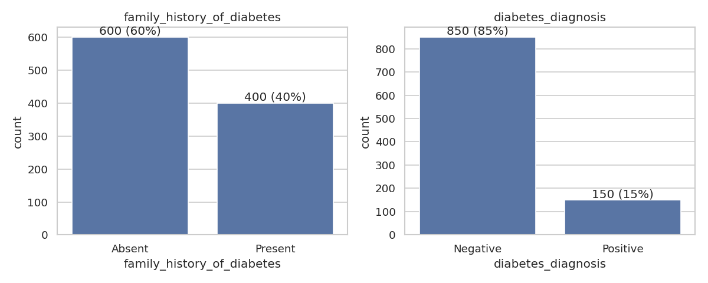
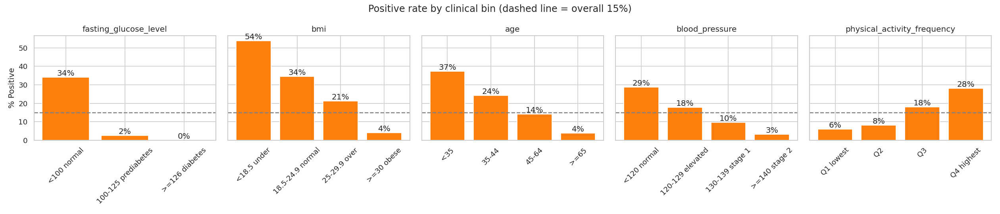
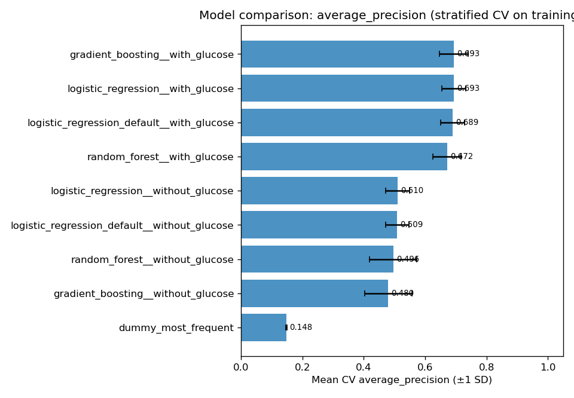
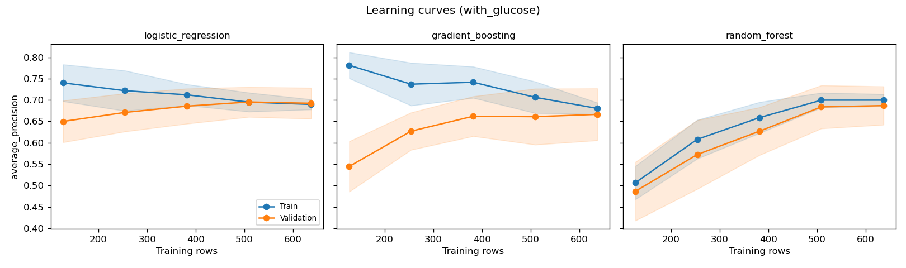
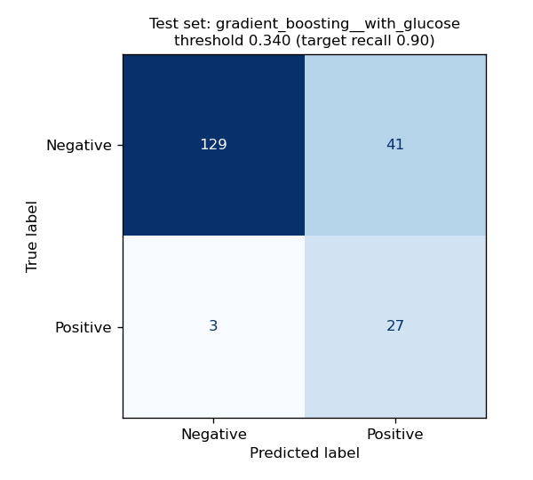

# Presentation outline

12 slides for about 15 minutes, for the capstone audience. Each slide has its content, a figure where useful, and speaker notes. Figures are in `reports/figures/`.

---

## Slide 1: Early detection of diabetes risk

**AIAP Foundation, Module 7 capstone**

- A screening classifier from seven routine health indicators
- Finding: the simple model won, and the data has a serious problem

**Speaker notes:** Introduce yourself and the project. Set up the two messages to remember: a simple model was as good as anything else, and being careful about the data mattered more than the choice of algorithm.

---

## Slide 2: The problem

- Diabetes often goes undetected for years
- Early flagging allows earlier follow-up and lifestyle change
- Errors aren't equal:
  - **False negative:** a missed person, the costly error
  - **False positive:** a cheap follow-up test
- **Goal: catch 90% of positives**

**Speaker notes:** This is a screening tool, not a diagnostic one. That's why recall is the priority. Accuracy is misleading here: always predicting Negative scores 85% and catches nobody.

---

## Slide 3: The data

- 1,000 synthetic records, 7 features, 15% positive
- Structurally clean: no missing values or duplicates
- 3 under-18s dropped, leaving **997 rows and 148 positives**
- 80/20 stratified split: only **30 positives in the test set**
- Outliers kept: 35% of them are Positive



**Speaker notes:** Stress the small number of positives. It shapes every later decision: few features, simple models, confidence intervals, and repeated cross-validation.

---

## Slide 4: The surprise

**Positives look healthier, not sicker.**

| Measure | Negative | Positive | Expected |
|---|---|---|---|
| Age | 56.3 | 44.9 | Positive older |
| BMI | 30.7 | 25.8 | Positive higher |
| Fasting glucose | 107.9 | 86.0 | Positive higher |

- 6 of 7 features run against clinical knowledge
- None of the 86 people with glucose ≥ 126 mg/dL is Positive



**Speaker notes:** This is the most important slide. Explain that swapping the labels doesn't fix it: family history would become protective and prevalence would be 85%. We modelled the label as given, reported it as a limitation, and it needs raising with the data provider. Nothing later can be read as clinical truth.

---

## Slide 5: Design decisions from the evidence

| Decision | Why |
|---|---|
| Logistic Regression baseline | Literature, and near-linear relationships in the EDA |
| No SMOTE; class weights and threshold tuning | Resampling harms calibration |
| PR-AUC to select, recall as the goal | Imbalanced data |
| With and without glucose | Non-laboratory screening; leakage concern |
| Everything inside a `Pipeline` | No leakage across folds |

**Speaker notes:** Each decision traces back to evidence from the literature or the EDA. Mention that glucose was tested as leakage: it's dominant, but not deterministic.

---

## Slide 6: Feature engineering

- Reusable scikit-learn transformer
- 7 clinical candidates: transforms, bands, flags, an interaction
- Each tested alone against the baseline, with the rule set in advance
- **None was kept.** Best gain: +0.003 PR-AUC, with fold noise of about 0.04

**Speaker notes:** This is a real result. Relationships were already monotonic and near-linear, so there was little to add. Setting the rule in advance is what makes "nothing worked" a finding and not a failure.

---

## Slide 7: Baseline vs advanced models

| Model | Architecture | PR-AUC with glucose | PR-AUC without |
|---|---|---|---|
| Dummy | Always Negative | 0.148 | 0.148 |
| **Logistic Regression** | Linear | **0.693** | **0.510** |
| Random Forest | Bagging | 0.672 | 0.496 |
| Gradient Boosting | Boosting | **0.693** | 0.480 |

- Paired fold comparison: no reliable gain from either ensemble (p ≥ 0.28)



**Speaker notes:** Gradient Boosting led by 0.0003 with glucose, which is pure noise. Without glucose, the ensembles were worse and less stable. This matches Christodoulou et al., 2019.

---

## Slide 8: Fixing overfitting

| Model | Gap before | Gap after |
|---|---|---|
| Random Forest, with glucose | +0.260 | **+0.023** |
| Random Forest, without glucose | +0.191 | **+0.048** |
| Gradient Boosting, without glucose | +0.257 | **+0.055** |

- Repeated CV, wider random search, one-SE refit, nested CV
- Overfitting fixed, but **no real score gain**
- Gradient Boosting without glucose went too far and now underfits



**Speaker notes:** Be honest that the search regularised hard, and for Gradient Boosting too hard. Logistic Regression wasn't underfitting either: degree-2 terms scored lower. The learning curve shows train and validation meeting for Logistic Regression, so more tuning won't help it.

---

## Slide 9: Final model and results

**Logistic Regression, in both variants**

| | With glucose | Without glucose |
|---|---|---|
| Recall | 0.87 [0.73–0.97] | 0.87 [0.73–0.97] |
| ROC-AUC | 0.944 | 0.849 |
| PR-AUC | 0.759 | 0.606 |
| Missed / false alarms | 4 / 31 | 4 / 54 |



**Speaker notes:** It selected itself: the highest repeated-CV score, and the simplest. Recall is one person short of the 90% target, well within the interval. Glucose saves 23 false alarms at the same recall. The no-lab model is still a usable first-pass screen.

---

## Slide 10: From notebook to service

- `src/predict.py`: model and threshold together, same validation as training
- FastAPI service: `/health` and `/predict`
- Dockerfile, 200+ tests, reproducible runs
- Full documentation in `documentation/`

```bash
curl -X POST localhost:8000/predict -H 'Content-Type: application/json' -d '{"records": [...]}'
```

**Speaker notes:** If time allows, demo a live request at `/docs`. Testing found a real bug: a NaN in a request crashed the error handler. Say plainly that the Docker image hasn't been built yet, and that there's no authentication. It's a packaged demonstration, not a clinical product.

---

## Slide 11: Limitations

- **The label contradicts medicine: do not use clinically**
- Synthetic data, so real-world performance is unknown
- Only 30 test positives, so intervals are wide
- Test results were seen before final selection, though selection used CV only
- Scores rank people, but aren't probabilities
- Fairness couldn't be assessed

**Speaker notes:** Don't rush this slide. Knowing what your model can't do is part of the work. A 104-year-old with BMI 37 and high blood pressure scores 0.008, which shows exactly why this can't be used on real people.

---

## Slide 12: Takeaways and next steps

**Takeaways**

1. Understand the data before modelling it
2. Start simple, and make complexity prove itself
3. Fair validation changes conclusions
4. Set your rules before you see the results

**Next steps**

1. Confirm the label definition
2. Validate on real data
3. Calibrate, then assess fairness

**Speaker notes:** Close on the first takeaway. The strongest finding came from the EDA, not from a model. Then invite questions.

---

## Likely questions

| Question | Answer |
|---|---|
| Why not just flip the labels? | Family history would become protective and prevalence would be 85%. That's not a clean fix, and it isn't our call without the data provider. |
| Why not SMOTE? | Evidence shows that it harms calibration without improving AUC. Class weights and thresholds reach the same trade-off. |
| Why keep glucose if it might be leakage? | The label wasn't derived from the ≥ 126 rule, and glucose isn't deterministic. We report both variants. |
| Why not deep learning? | 1,000 tabular rows. Tree ensembles usually beat it here, and they didn't beat Logistic Regression. |
| Why did recall miss 0.90? | The threshold reached 0.907 on training folds. On test it's one person short, and 0.90 is within the interval. |
| Is it ready for production? | The engineering is packaged. It isn't ready clinically, and it still needs authentication and monitoring. |
