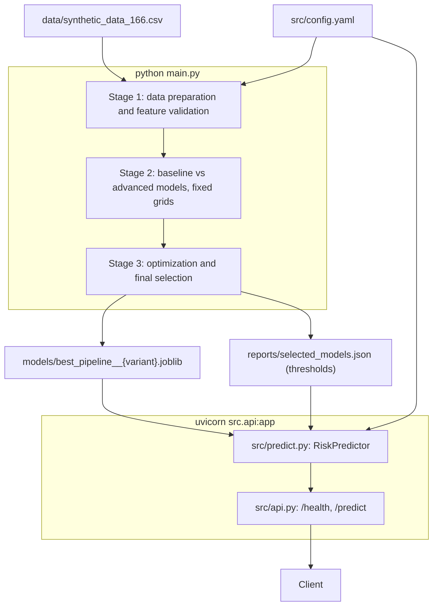

# Technical documentation

For engineers maintaining or extending the code. For how to call the service, see the [API reference](api_reference.md). For how to run it, see the [Deployment guide](deployment_guide.md).

## Architecture

The project has two parts that share one set of files on disk. `main.py` trains and writes the artifacts. `src/api.py` reads them and serves predictions.



## Repository layout

| Path | Purpose |
|---|---|
| `main.py` | Pipeline entry point: orchestrates the three stages |
| `src/config.yaml` | Every setting. No values are hard-coded in the pipeline |
| `src/config_validation.py` | Checks the config before anything runs |
| `src/data_preparation.py` | `DataPreparation`: validation report, cleaning, split, feature pipelines |
| `src/feature_engineering.py` | `ClinicalFeatureEngineer`, feature selection, feature-set comparison |
| `src/models.py` | `ModelTraining`: the baseline and the shared training machinery |
| `src/advanced_models.py` | `AdvancedModelTraining`: Random Forest and Gradient Boosting; `compare_to_baseline` |
| `src/model_optimization.py` | `ModelOptimizer`: repeated and nested CV, search, diagnostics, final selection |
| `src/evaluation.py` | Metrics, bootstrap confidence intervals, plots |
| `src/predict.py` | `RiskPredictor`: loads a model and threshold, validates input, scores |
| `src/api.py` | FastAPI service |
| `tests/` | pytest suite |
| `Dockerfile`, `.dockerignore` | Container for the API |

`models/`, `data/` and caches are git-ignored. `reports/` is committed, so results can be read without re-running.

## The pipeline

`python main.py` must run from the project root. It takes about 4 minutes on 16 cores, and the runs are reproducible: two runs give identical `optimization_results.json`.

**Stage 1: data preparation and feature validation**

1. Load and validate the config.
2. Load the CSV and check the required columns.
3. Write a data-quality report on the raw data.
4. Clean: drop duplicates, missing targets and under-18s; check category levels.
5. Make a stratified 80/20 split (797 / 200 rows).
6. Check each feature pipeline for NaNs and expected columns.
7. Rank features on training data with L1 and permutation importance.
8. Compare engineered feature sets with the raw baseline by CV.

**Stage 2: baseline vs advanced models**, in `_train_and_evaluate`

Fixed-grid `GridSearchCV` on one 5-fold split, a paired comparison with the baseline, and a test evaluation of every model. It returns the tuned models as the "before" reference for Stage 3, and it does not make the final choice.

**Stage 3: optimization and final selection**, in `_optimize_and_select`

Random search on repeated folds, one-SE refit, before/after diagnostics, nested CV and learning curves, then selection of the simplest model within 1 SE of the best. Only the selected models then go to the test set. This stage owns the final outputs: `selected_models.json`, `final_metrics.json`, `feature_importance.json`, the confusion matrices and the saved pipelines.

## Key design decisions

**Everything fitted lives in the pipeline.** Each model is `engineer` → `preprocessor` → (`poly`) → `classifier`, so cross-validation recomputes features and refits the scaler on each training fold. Validation rows never influence preprocessing.

**The test set is kept away from decisions.** `ModelOptimizer` receives only training data. Thresholds come from out-of-fold training predictions.

**Glucose variants are explicit.** Every model is built with and without glucose. `features_derived_from` also removes any engineered feature built from a leakage candidate, so nothing derived from glucose can slip into the `without_glucose` variant.

**Features are defined once.** `FEATURE_SPECS` in `feature_engineering.py` holds each feature's sources, builder, rationale and any raw feature it replaces. Config validation imports from it, so a feature can't be listed that doesn't exist.

**`ModelOptimizer` uses its own Logistic Regression build.** It adds a `poly` step and switches to the `liblinear` solver, so the saved pipelines have four steps while Stage 2's have three.

**Training and serving validate the same way.** `RiskPredictor` applies the rules of `clean_data`, using the same config: required columns, category levels and `min_age`. Plausible ranges only produce warnings, in both places.

## Configuration reference

All settings are in `src/config.yaml`.

**Data and split**

| Key | Value | Meaning |
|---|---|---|
| `file_path` | `./data/synthetic_data_166.csv` | Input CSV |
| `target_column` | `diabetes_diagnosis` | Column to predict |
| `positive_class` | `Positive` | Label encoded as 1 |
| `min_age` | `18` | Rows below this are dropped, and rejected by the API |
| `test_size` | `0.2` | Stratified test share |
| `random_state` | `42` | Seed used throughout |

**Features**

| Key | Meaning |
|---|---|
| `numeric_features` | The six scaled numeric inputs |
| `binary_features` | One-hot encoded inputs (`family_history_of_diabetes`) |
| `categorical_levels` | Allowed values of each text column |
| `leakage_candidate_features` | Removed in `without_glucose` |
| `lr_engineered_features` | Engineered features used by Logistic Regression. Currently empty |
| `candidate_features` | Engineered features to validate |
| `plausible_ranges` | Used to count and warn about suspicious values; nothing is dropped |

**Modelling**

| Key | Value | Meaning |
|---|---|---|
| `cv` | `5` | Folds, used everywhere |
| `scoring` | `average_precision` | PR-AUC, used for tuning and selection. May also be `roc_auc` |
| `target_recall` | `0.90` | Recall the decision threshold aims for |
| `n_jobs` | `-1` | Parallel workers; `-1` uses all cores |
| `param_grids` | | Stage 2 grids; one entry per model |
| `search_spaces` | | Stage 3 random-search spaces; one entry per model |
| `selection_scoring` | `average_precision` | Metric for feature selection |
| `min_cv_gain` | `0.005` | Minimum PR-AUC gain to keep an engineered feature |

**`optimization`**

| Key | Value | Meaning |
|---|---|---|
| `cv_repeats` | `3` | Repeats of the 5-fold split |
| `n_iter` | `30` | Random-search candidates per model and variant |
| `nested_n_iter` | `10` | Candidates per outer fold of nested CV |
| `max_fit_gap` | `0.10` | Train−validation gap above which a model is labelled overfit |
| `learning_curve_points` | `5` | Training sizes, from 20% to 100% |

## Outputs

| File in `reports/` | Stage | Contents |
|---|---|---|
| `data_validation_report.json` | 1 | Data-quality counts on the raw data |
| `data_preparation_summary.json` | 1 | Row counts, splits, features per variant |
| `feature_selection.json` | 1 | L1 coefficients and permutation rankings |
| `feature_comparison.json` | 1 | CV scores per feature set and recommended features |
| `cv_results.json` | 2 | Per-fold CV scores of all fixed-grid models |
| `model_comparison.json` | 2 | Paired CV gains, test metrics with CIs, cost |
| `optimization_results.json` | 3 | Searches, before/after fit, nested CV, learning curves, selection |
| `selected_models.json` | 3 | Final model, hyperparameters, features and threshold. **Read by the API** |
| `final_metrics.json` | 3 | Test metrics of the final models and the dummy |
| `feature_importance.json` | 3 | Permutation importance of the final models |
| `figures/` | All | EDA and evaluation plots |

`models/best_pipeline__{variant}.joblib` holds the final pipelines, including feature engineering and preprocessing.

## Testing

```bash
pip install -r requirements-dev.txt
python -m pytest
```

The suite takes about 30 seconds. It uses a tiny config and generated data from `tests/conftest.py`, so it needs neither the CSV nor a pipeline run. One exception is `test_project_config_file_is_valid`, which reads the real `src/config.yaml`.

| Test file | Covers |
|---|---|
| `test_config_validation.py` | Every config rule |
| `test_data_preparation.py` | Reports, cleaning, split, feature pipelines |
| `test_feature_engineering.py` | The transformer, each feature, selection and comparison |
| `test_models.py`, `test_advanced_models.py` | Pipelines, tuning, thresholds, the paired comparison |
| `test_evaluation.py` | Metrics, thresholds, bootstrap intervals |
| `test_model_optimization.py` | The refit rule, diagnosis, selection, search reproducibility |
| `test_pipeline_integration.py` | Tuning to test evaluation, end to end |
| `test_predict.py`, `test_api.py` | Input validation, thresholds, status codes |

## How to extend

**Add an engineered feature**

1. Add a `FeatureSpec` to `FEATURE_SPECS`, using its source columns and a builder that uses only that row's values.
2. Add its name to `candidate_features` in the config.
3. Run `python main.py` and read `reports/feature_comparison.json`.
4. To use it, add it to `lr_engineered_features`. `main.py` warns if this disagrees with the recommendation.

**Add a model**

1. Add a factory to `_classifier_factories` and the name to `MODEL_NAMES` in `AdvancedModelTraining`.
2. Add the name to `MODEL_NAMES` in `config_validation.py`, and to `ModelOptimizer.MODELS_SIMPLEST_FIRST` in order of complexity.
3. Add an entry to `ARCHITECTURES` in `main.py`.
4. Add entries to `param_grids` and `search_spaces` in the config.

**Change the recall target**

Set `target_recall` and re-run `python main.py`. This changes the thresholds in `selected_models.json`, which the API uses after a restart.

## Known limitations of the code

- `main.py` always runs all three stages. There's no option to run only one.
- Stage 2 evaluates every model on the test set before Stage 3 chooses. The choice uses CV only, but see [Limitations](model_explanation.md#limitations).
- The `*_trees` and `*_logistic_regression` variants currently hold the same features, because no engineered feature was kept.
- The saved pipelines are pickles, so they need the same `src/` code and scikit-learn version to load.
